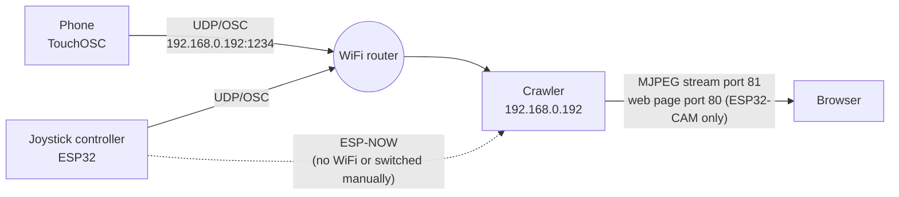
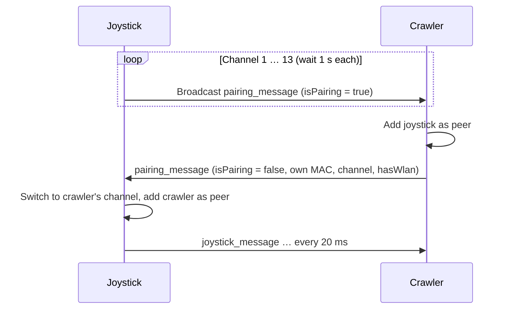

# Crawler

Remote-controlled tracked vehicles (crawlers) based on ESP microcontrollers. There are two crawler variants running the same firmware, and two ways to control them.


*Left: the Wemos crawler (beige). Right: the ESP32-CAM crawler with camera (dark green).*

| Variant | Controller | Motors | Extras |
|---|---|---|---|
| **ESP32-CAM crawler** ("type 1") | ESP32-CAM (AI-Thinker) | PCA9685 → DRV8833 | Camera with live stream; front, tail, brake and reversing lights |
| **Wemos crawler** ("type 2") | Wemos D1 mini (ESP8266) | DRV8833 directly on GPIO | WiFi status LED |

| Control | Hardware | Transport |
|---|---|---|
| **TouchOSC** | App on the phone | WiFi, UDP/OSC |
| **Joystick controller** | ESP32 with analog joystick, push button, 2 touch switches, 2 NeoPixels | WiFi UDP/OSC, or ESP-NOW (fallback without WiFi, or switched manually with touch L+R) |
| **Web page** (ESP32-CAM only) | Browser on the phone | WiFi, HTTP |

All devices are battery powered.

## Repository contents

| Folder | Contents | Origin |
|---|---|---|
| `crawler/` | Firmware for both crawlers (version 11) | `combi10` |
| `OSC_Joystick/` | Firmware for the joystick controller (version 11) | `OSC_Joystick10` |
| `docs/` | Photo and schematics | – |

Version history according to the header comment in `crawler.ino`: 6 lights · 7 front lights · 8 camera · 9 restructured · 10 ESP-NOW handshake · 11 ESP32 core 3.x, OTA with FPV, web controls, ESP-NOW with buttons, ESP8266 build, manual WiFi/ESP-NOW switch on the joystick.

---

## System overview



The crawler always listens on UDP/OSC (port 1234) and ESP-NOW at the same time. The sender alone decides which path is used.

### Network settings (hard-coded)

| Parameter | Value | File |
|---|---|---|
| WiFi credentials | `ssid`, `password` from `<Credentials.h>` | both |
| Crawler IP | `192.168.0.192` (static), gateway `192.168.0.1`, mask `255.255.255.0` | `crawler/crawler.ino` |
| Crawler MAC | `3C:61:05:D0:53:5C` (set at startup) | `crawler/crawler.ino`, `OSC_Joystick/OSC_Joystick.ino` |
| Crawler OSC port | UDP `1234` | both |
| Joystick local UDP port | `8888` | `OSC_Joystick/OSC_Joystick.ino` |
| Hostname | `ESP-Crawler` (mDNS: `ESP-Crawler.local`, also used for OTA) | `crawler/crawler.ino` |

Because both crawlers use the same IP and the same MAC, only one can be operated at a time.

---

## Control

### 1. TouchOSC (phone)

The TouchOSC layout sends to `192.168.0.192:1234`:

| OSC address | Arguments | Effect |
|---|---|---|
| `/Crawler/xy1` | 2 floats X, Y (0…1) | XY pad for driving; only executed while the enable toggle is on |
| `/Crawler/toggle1` | 1 float (0/1) | Enable; switching it off stops the motors immediately |

The crawler identifies the sender by the number of arguments: two arguments mean phone (`isPhone = true`). The TouchOSC layout file is not in the repository yet.

### 2. Joystick controller (ESP32)

At power-on:

1. NeoPixel #0 lights red.
2. Connects to WiFi, at most 20 attempts of 0.5 s each. NeoPixel #1 blinks red meanwhile. Afterwards it is off if WiFi is connected, or steady red if not.
3. Selects the mode: **WiFi (OSC) if the joystick could connect, otherwise ESP-NOW.**
4. In ESP-NOW mode it searches the crawler channel by channel, see [ESP-NOW pairing](#esp-now-pairing).

NeoPixel #0 shows the mode: **green** = WiFi/OSC, **blue** = ESP-NOW connected, **orange** = ESP-NOW, searching the crawler.

**Manual switch:** Hold touch switches **L and R together for about 1 s**, then release both. This toggles WiFi ↔ ESP-NOW. Use it when the crawler has no WiFi but the joystick has. Switching to ESP-NOW leaves the WiFi (a neutral OSC packet is sent first, so the crawler stops). Switching to WiFi reconnects; if that fails, the joystick stays on ESP-NOW.

**Automatic mode (optional):** `#define AUTO_MODE_SWITCH` in `OSC_Joystick.ino` (off by default). Then the joystick asks the crawler at startup whether it has WiFi and uses ESP-NOW if not, and falls back to ESP-NOW when its own WiFi is lost for more than 3 s. It is off by default because the crawler may not be running yet when the joystick starts, and to avoid unwanted switching.

**OTA:** hostname `ESP-Joystick` (DHCP address), only available in WiFi mode.

During operation it sends every 20 ms, even without changes (`repetitive = true`). In ESP-NOW mode the joystick searches the crawler again after about 0.5 s of failed sends.

| Control | OSC mode | ESP-NOW mode |
|---|---|---|
| Joystick X/Y | `/Crawler/xy1` with 3 arguments (X, Y, button) | `joystick_message` packet |
| Joystick button (fire) | 3rd argument → output "fireOut" (PCA channel 12) | `button1` → output "fireOut" |
| Enable button (full light) | toggles `enableButton`, the button LED shows the state, sends `/Crawler/toggle1` → brighter front light | `button2` → brighter front light |
| Touch L + R | switch to ESP-NOW | switch to WiFi |

Scaling: steering is limited to 1/3 in both modes.

- OSC: X is mapped to 0.33…0.66. Y is inverted and mapped to 1.0…0.0.
- ESP-NOW: the center is subtracted, a deadzone of ±50 applied, the value scaled to ±512, X divided by 3 and Y inverted.

In joystick mode (3 arguments) the crawler drives without the enable toggle.

### 3. Web page (ESP32-CAM only)

`http://192.168.0.192/` shows the camera image and the controls (page source: `crawler/index_html.h`):

- **XY pad** for tank steering like the TouchOSC pad, steering limited to 1/3 (`STEER_FACTOR`). Releasing the pad stops the crawler.
- **Light** toggles the full front light, **Fire** is active while held.
- While the pad or Fire is touched, the page sends `/action?go=xy&x=…&y=…&f=…` every 100 ms (x, y: −512…512). If no command arrives for 500 ms (pad released, tab in the background, connection lost), the crawler stops and switches Fire off.
- `/action?go=light&v=0|1` switches the full light.
- The old commands `/action?go=forward|backward|left|right|stop` (fixed speed `webSpeed = 150`) still work.

`http://192.168.0.192:81/stream` delivers the MJPEG stream: VGA with PSRAM, SVGA without. The image is mirrored and flipped (rotated by 180°). **While a client watches the stream, OTA is paused** (the OTA check would make the image stutter); it is available again as soon as the stream is closed.

---

## Protocols

### ESP-NOW messages

```c
typedef struct joystick_message {
  int16_t x;       // -512 … 512
  int16_t y;       // -512 … 512  (negative = forward)
  bool button1;    // fire (held)
  bool button2;    // full front light (toggle state)
  uint8_t target;  // unused (intended: 1, 2 or 0 = all)
} joystick_message;  // 8 bytes

typedef struct pairing_message {
  uint8_t mac_addr[6];
  uint8_t channel;
  bool isPairing;  // true = request, false = confirmation
  bool hasWlan;    // confirmation only: crawler is connected to WiFi
} pairing_message;  // 9 bytes
```

The crawler distinguishes the two messages by their length; a `static_assert` makes sure the sizes differ. (In version 10 both were 8 bytes, so joystick packets were taken for pairing messages and never drove the crawler.)

The crawler takes joystick packets without a prior pairing, so the joystick keeps working after a crawler reboot. The packets are only stored in the ESP-NOW callback and applied in `loop()`. If no packet arrives for 500 ms, the crawler stops and switches Fire off.

### ESP-NOW pairing



In its confirmation the crawler reports its channel (`homeChannel`). With WiFi this is the channel of the access point. Without WiFi the crawler stops the background reconnect (which hops channels) and stays on **channel 1**. The joystick scans one channel per loop and keeps searching until it finds the crawler, so it can be switched on before the crawler.

---

## Drive and light logic (crawler)

**Mixing (tank steering):** `left = Y + X`, `right = Y − X`. The range ±512 is mapped to the PWM range: PCA ±4095 at 100 Hz, GPIO ±1023 at 20 kHz. Below a deadzone of 100 the motors stand still.

**Type detection at startup:** If a device answers on I²C address `0x40` (PCA9685), the crawler runs as type 1, otherwise as type 2.

**Lights (type 1 only, via PCA9685):**

| State | Lights |
|---|---|
| Startup | white reversing lights bright |
| Connecting to WiFi | white lights blink |
| WiFi connected | red tail light dimmed (200), front light low |
| Braking (twice above, then twice below the deadzone) | brake light: red +2000 for 1 s |
| Reversing (two packets in a row) | white reversing light (400) |
| Full light (`/Crawler/toggle1` in joystick mode, ESP-NOW `button2`, web "Light") | brighter front light (+65) |
| Fire (joystick button, web "Fire") | output "fireOut" (channel 12) fully on |

**Type 2:** The WiFi LED on D7 blinks while connecting and stays on once WiFi is connected.

---

## Hardware and schematics

The schematics are derived from the code. All three devices run on battery. Battery type, voltage regulators and the exact wiring of the DRV8833 modules are not defined in the code and are therefore not shown in detail.

### ESP32-CAM crawler (type 1)


| ESP32-CAM | Connection |
|---|---|
| GPIO13 | I²C SDA → PCA9685 |
| GPIO14 | I²C SCL → PCA9685 |
| GPIO4 | Flash LED, set as output (off) |
| GPIO12 | set HIGH at startup (comment: "because of PCA conflict with SDA") |
| Camera | internal AI-Thinker pinout (PWDN 32, XCLK 0, SIOD 26, SIOC 27, Y2–Y9, VSYNC 25, HREF 23, PCLK 22) |

| PCA9685 channel | Function |
|---|---|
| 2 / 3 | Motor 1 (left), IN1 / IN2 |
| 1 / 0 | Motor 2 (right), IN1 / IN2 |
| 4 / 8 | Red tail and brake light, right / left |
| 5 / 9 | White reversing light, right / left |
| 6 / 10 | Front light, right / left (base brightness 7 / 3) |
| 12 | "fireOut" (joystick button) |

### Wemos D1 mini crawler (type 2)


| Wemos pin | GPIO | Function |
|---|---|---|
| D6 | 12 | Motor 1 (left) IN1 |
| D5 | 14 | Motor 1 (left) IN2 |
| D1 | 5 | Motor 2 (right) IN1 |
| D2 | 4 | Motor 2 (right) IN2 |
| D7 | 13 | WiFi LED |

The motors run in "slow decay" mode: one input is held HIGH, the other receives the inverted PWM.

> The code also supports an ESP32 with motors directly on GPIO 12/13 (motor 1) and 27/25 (motor 2) and an LED on GPIO 14. On the ESP32-CAM these pins collide with the camera and I²C, so this variant only makes sense without `FPV`.

### Joystick controller (ESP32)


| GPIO | Function |
|---|---|
| 33 | Joystick X (ADC) |
| 32 | Joystick Y (ADC) |
| 25 | Joystick button (internal pull-up, active LOW) |
| 36 | Enable button (active LOW, external pull-up required) |
| 27 | Enable button LED |
| 35 / 34 | Switch L / R (not evaluated) |
| 14 | 2× WS2812: #0 right = mode, #1 left = WiFi |
| 5 | Board LED (on) |

---

## Building

**Common:** The file `Credentials.h` must be placed as a library in the Arduino `libraries` folder and define `ssid` and `password`. It is intentionally not part of the repository (see `.gitignore`).

Required libraries:

- `OSCMessage` (CNMAT OSC)
- `Streaming`
- `Adafruit PWM Servo Driver` (crawler)
- `Adafruit NeoPixel` (joystick)
- `ArduinoOTA`, `esp_camera`: included in the board package

**ESP32 board package:** Tested with Arduino-ESP32 core **3.3.10**. Version checks (`ESP_ARDUINO_VERSION_MAJOR`, `ESP_IDF_VERSION`) keep it compatible with core 2.x. ESP8266 tested with core **3.1.2**.

**Libraries:** `OSC` (CNMAT), `Adafruit PWM Servo Driver Library`, `Streaming`, `Adafruit NeoPixel` (joystick), and your own `Credentials.h`.

**Crawler:** The platform is taken from the selected board, nothing to edit in the code. `FPV` (camera, web page) is enabled automatically on the ESP32.

| Target | Board | Settings |
|---|---|---|
| ESP32-CAM | "AI Thinker ESP32-CAM" (`esp32:esp32:esp32cam`) | Partition scheme **"Minimal SPIFFS (1.9MB APP with OTA)"** – the default "Huge APP" has no OTA partition. Serial upload may need 115200 baud. |
| Wemos D1 mini | "LOLIN(WEMOS) D1 R2 & mini" (`esp8266:esp8266:d1_mini`) | OTA port 8266 |

`DEBUG` and `FIXESP` enable additional serial output (115200 baud).

**Joystick:** board "ESP32 Dev Module" (`esp32:esp32:esp32`), default partition scheme (with OTA).

**OTA:** Crawler `ESP-Crawler` (192.168.0.192), joystick `ESP-Joystick` (WiFi mode only). The first upload with OTA support has to be done via USB.

---

## Known issues / open tasks

Fixed in version 11: WiFi/ESP-NOW fallback (manual switch, optional automatic mode), ESP8266 build, OTA on the ESP32-CAM, ESP-NOW buttons, L/R switches, web page controls, ESP-NOW message size collision, crash on the Wemos crawler (PCA9685 accessed without PCA), PWM range on ESP8266 core 3.x.

Still open:

1. **Joystick center hard-coded and inconsistent:** OSC uses `midX = 1947`, `midY = 1936`, ESP-NOW uses `joystickCenterX = 1935`, `joystickCenterY = 1947`. X and Y appear to be swapped. A calibration at startup would help.
2. **Pairing:** The crawler accepts any pairing request and any joystick packet.
3. **Same IP/MAC for both crawlers:** They cannot be operated at the same time.
4. **OSC has no timeout:** If the WiFi connection drops while driving via OSC, the crawler keeps the last command (TouchOSC only sends on changes, so a timeout cannot simply be added).
5. **TouchOSC layout:** The layout file is still missing from the repository and will be added later.
