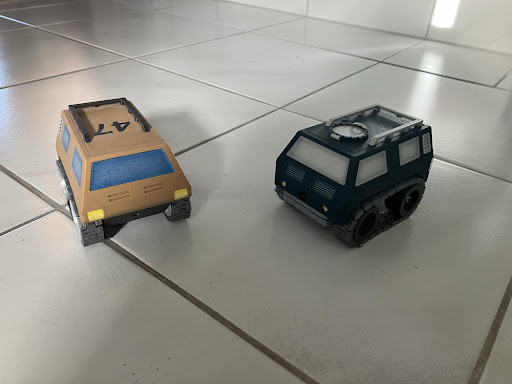
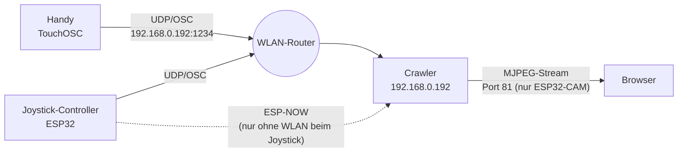
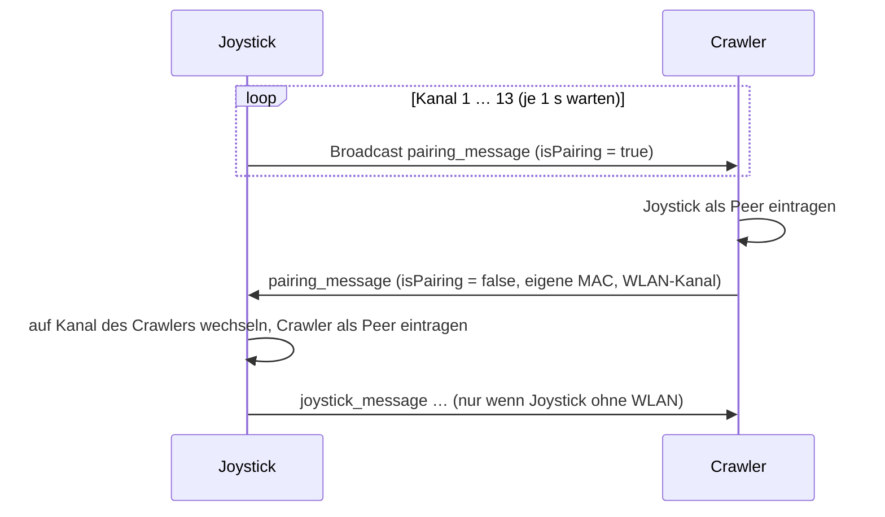
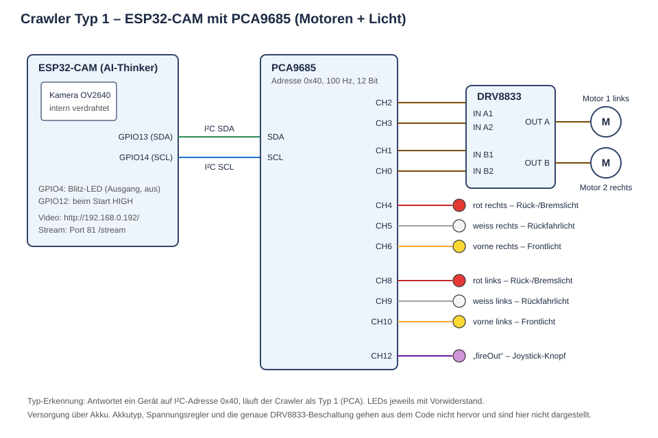
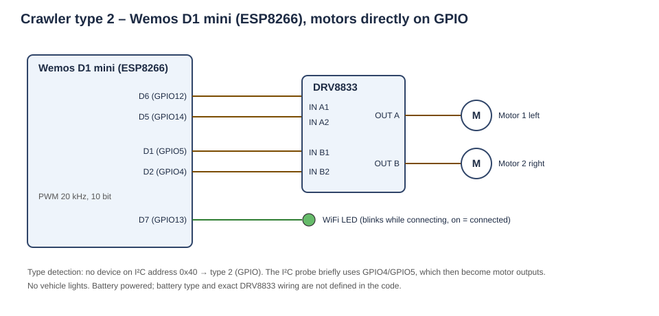
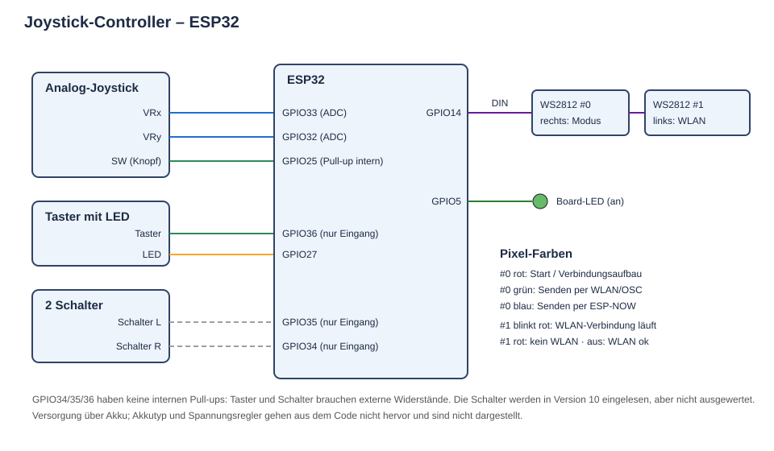

# Crawler

Ferngesteuerte Raupenfahrzeuge (Crawler) auf ESP-Basis. Es gibt zwei Ausführungen, die mit derselben Firmware laufen, und zwei Arten der Fernsteuerung.



*Links der Wemos-Crawler (beige), rechts der ESP32-CAM-Crawler mit Kamera (dunkelgrün).*

| Ausführung | Controller | Motoren | Extras |
|---|---|---|---|
| **Crawler ESP32-CAM** („Typ 1“) | ESP32-CAM (AI-Thinker) | PCA9685 → DRV8833 | Kamera mit Live-Stream, Front-, Rück-, Brems- und Rückfahrlicht |
| **Crawler Wemos** („Typ 2“) | Wemos D1 mini (ESP8266) | DRV8833 direkt an GPIO | WLAN-Status-LED |

| Steuerung | Hardware | Übertragung |
|---|---|---|
| **TouchOSC** | App auf dem Handy | WLAN, UDP/OSC |
| **Joystick-Controller** | ESP32 mit Analog-Joystick, Taster, 2 Schaltern, 2 NeoPixeln | WLAN, UDP/OSC, oder ESP-NOW als Ersatz, wenn der Joystick kein WLAN findet |

## Inhalt des Repositorys

| Ordner | Inhalt | Ursprung |
|---|---|---|
| `crawler/` | Firmware für beide Crawler (Version 10) | `combi10` |
| `OSC_Joystick/` | Firmware für den Joystick-Controller (Version 10) | `OSC_Joystick10` |
| `docs/` | Foto und Schemas | – |

Versionsgeschichte laut Kopfkommentar in `crawler.ino`: 6 Lampen · 7 Vorderlampen · 8 Kamera · 9 strukturiert · 10 ESP-NOW-Handshake.

---

## Systemübersicht



Der Crawler hört immer gleichzeitig auf UDP/OSC (Port 1234) und ESP-NOW. Welcher Weg genutzt wird, entscheidet allein der Sender.

### Netzwerk-Einstellungen (fest im Code)

| Parameter | Wert | Datei |
|---|---|---|
| WLAN-Zugangsdaten | `ssid`, `password` aus `<Credentials.h>` | beide |
| IP des Crawlers | `192.168.0.192` (statisch), Gateway `192.168.0.1`, Maske `255.255.255.0` | `crawler/crawler.ino` |
| MAC des Crawlers | `3C:61:05:D0:53:5C` (wird beim Start gesetzt) | `crawler/crawler.ino`, `OSC_Joystick/OSC_Joystick.ino` |
| OSC-Port des Crawlers | UDP `1234` | beide |
| Lokaler UDP-Port des Joysticks | `8888` | `OSC_Joystick/OSC_Joystick.ino` |
| Hostname | `ESP-Crawler` (mDNS: `ESP-Crawler.local`, auch für OTA) | `crawler/crawler.ino` |

Da beide Crawler dieselbe IP und dieselbe MAC verwenden, kann immer nur einer gleichzeitig betrieben werden.

---

## Steuerung

### 1. TouchOSC (Handy)

Das TouchOSC-Layout sendet an `192.168.0.192:1234`:

| OSC-Adresse | Argumente | Wirkung |
|---|---|---|
| `/Crawler/xy1` | 2 Floats X, Y (0…1) | XY-Pad zum Fahren; wird nur ausgeführt, wenn der Freigabeschalter an ist |
| `/Crawler/toggle1` | 1 Float (0/1) | Freigabe; beim Ausschalten stoppen die Motoren sofort |

An der Anzahl der Argumente erkennt der Crawler, wer sendet: zwei Argumente bedeuten Handy (`isHandy = true`). Die Layout-Datei für TouchOSC ist nicht im Repository.

### 2. Joystick-Controller (ESP32)

Beim Einschalten:

1. NeoPixel #0 leuchtet rot.
2. Verbindung mit dem WLAN, höchstens 20 Versuche à 0,5 s. NeoPixel #1 blinkt dabei rot. Danach ist er aus, wenn das WLAN verbunden ist, oder dauerhaft rot, wenn nicht.
3. ESP-NOW-Pairing, siehe [ESP-NOW-Pairing](#esp-now-pairing).
4. Auswahl des Übertragungswegs. **ESP-NOW wird nur genutzt, wenn der Joystick kein WLAN hat und das Pairing geklappt hat.** Sonst sendet er per UDP/OSC.
5. NeoPixel #0 zeigt den Modus: grün für OSC, blau für ESP-NOW.

Im Betrieb wird alle 20 ms gesendet, auch ohne Änderung (`repetitive = true`).

| Bedienelement | OSC-Modus | ESP-NOW-Modus |
|---|---|---|
| Joystick X/Y | `/Crawler/xy1` mit 3 Argumenten (X, Y, Knopf) | Paket `joystick_message` |
| Joystick-Knopf | 3. Argument → Ausgang „fireOut“ (PCA-Kanal 12) | wird als `button1` gesendet, aber vom Crawler nicht ausgewertet |
| Taster | schaltet `enableButton` um, Taster-LED zeigt den Zustand, sendet `/Crawler/toggle1` → am ESP32-CAM-Crawler helleres Frontlicht | ohne Funktion |
| Schalter L / R | ohne Funktion | ohne Funktion |

Skalierung:

- OSC: X wird auf 0,33…0,66 abgebildet, die Lenkung ist also gedämpft. Y wird invertiert auf 1,0…0,0 abgebildet.
- ESP-NOW: Die Mitte wird abgezogen, mit einer Totzone von ±50 auf ±512 skaliert, X durch 5 geteilt und Y invertiert.

Im Joystick-Modus (3 Argumente) fährt der Crawler ohne Freigabe.

### 3. Web-Oberfläche (nur ESP32-CAM)

- `http://192.168.0.192/` zeigt eine Seite „RC Crawler 2d“ mit dem Kamerabild.
- `http://192.168.0.192:81/stream` liefert den MJPEG-Stream: VGA mit PSRAM, sonst SVGA. Das Bild ist gespiegelt und um 180° gedreht.
- `http://192.168.0.192/action?go=forward|backward|left|right|stop` enthält Fahrbefehle mit fester Geschwindigkeit `webSpeed = 150`. Die Seite selbst hat keine Knöpfe dafür.

---

## Protokolle

### ESP-NOW-Nachrichten

```c
typedef struct joystick_message {
  int16_t x;       // -512 … 512
  int16_t y;       // -512 … 512  (negativ = vorwärts)
  bool button1;
  bool button2;    // ungenutzt
  uint8_t target;  // ungenutzt (gedacht: 1, 2 oder 0 = alle)
} joystick_message;

typedef struct pairing_message {
  uint8_t mac_addr[6];
  uint8_t channel;
  bool isPairing;  // true = Anfrage, false = Bestätigung
} pairing_message;
```

Der Crawler unterscheidet die beiden Nachrichten an ihrer Länge.

### ESP-NOW-Pairing



Der Crawler meldet in der Bestätigung den Kanal seines WLANs (`homeChannel`). Findet der Joystick auf keinem Kanal einen Crawler, gilt ESP-NOW als nicht verfügbar.

---

## Fahr- und Lichtlogik (Crawler)

**Mischung (Panzersteuerung):** `links = Y + X`, `rechts = Y − X`. Der Bereich ±512 wird auf den PWM-Bereich abgebildet: PCA ±4095 bei 100 Hz, GPIO ±1023 bei 20 kHz. Unter einer Totzone von 100 stehen die Motoren still.

**Typ-Erkennung beim Start:** Antwortet ein Gerät auf I²C-Adresse `0x40` (PCA9685), läuft der Crawler als Typ 1, sonst als Typ 2.

**Licht (nur Typ 1, über PCA9685):**

| Zustand | Licht |
|---|---|
| Start | weisse Rückfahrlichter hell |
| WLAN-Verbindung läuft | weisse Lichter blinken |
| WLAN verbunden | Rücklicht rot gedimmt (200), Frontlicht schwach |
| Abbremsen (zweimal über, dann zweimal unter der Totzone) | Bremslicht: rot +2000 für 1 s |
| Rückwärtsfahrt (zwei Pakete in Folge) | Rückfahrlicht weiss (400) |
| `/Crawler/toggle1` im Joystick-Modus | Frontlicht heller (+65) |
| Joystick-Knopf | Ausgang „fireOut“ (Kanal 12) voll an |

**Typ 2:** Die WLAN-LED an D7 blinkt beim Verbinden und leuchtet, sobald das WLAN verbunden ist.

---

## Hardware und Schemas

Die Schemas sind aus dem Code abgeleitet. Alle drei Geräte laufen mit Akku. Akkutyp, Spannungsregler und die genaue Beschaltung der DRV8833-Module gehen aus dem Code nicht hervor und sind deshalb nicht im Detail dargestellt.

### Crawler ESP32-CAM (Typ 1)



| ESP32-CAM | Verbindung |
|---|---|
| GPIO13 | I²C SDA → PCA9685 |
| GPIO14 | I²C SCL → PCA9685 |
| GPIO4 | Blitz-LED, als Ausgang gesetzt (aus) |
| GPIO12 | wird beim Start HIGH gesetzt (Kommentar: „wegen Konflikt mit SDA“) |
| Kamera | interne AI-Thinker-Belegung (PWDN 32, XCLK 0, SIOD 26, SIOC 27, Y2–Y9, VSYNC 25, HREF 23, PCLK 22) |

| PCA9685-Kanal | Funktion |
|---|---|
| 2 / 3 | Motor 1 (links), IN1 / IN2 |
| 1 / 0 | Motor 2 (rechts), IN1 / IN2 |
| 4 / 8 | Rück- und Bremslicht rot, rechts / links |
| 5 / 9 | Rückfahrlicht weiss, rechts / links |
| 6 / 10 | Frontlicht, rechts / links (Grundhelligkeit 7 / 3) |
| 12 | „fireOut“ (Joystick-Knopf) |

### Crawler Wemos D1 mini (Typ 2)



| Wemos-Pin | GPIO | Funktion |
|---|---|---|
| D6 | 12 | Motor 1 (links) IN1 |
| D5 | 14 | Motor 1 (links) IN2 |
| D1 | 5 | Motor 2 (rechts) IN1 |
| D2 | 4 | Motor 2 (rechts) IN2 |
| D7 | 13 | WLAN-LED |

Die Motoren laufen im „Slow Decay“: Ein Eingang liegt auf HIGH, der andere bekommt die invertierte PWM.

> Der Code kennt auch einen ESP32 mit Motoren direkt an GPIO 12/13 (Motor 1) und 27/25 (Motor 2) sowie einer LED an GPIO 14. Auf der ESP32-CAM kollidieren diese Pins mit Kamera und I²C, die Variante ist also nur ohne `FPV` sinnvoll.

### Joystick-Controller (ESP32)



| GPIO | Funktion |
|---|---|
| 33 | Joystick X (ADC) |
| 32 | Joystick Y (ADC) |
| 25 | Joystick-Knopf (interner Pull-up, aktiv LOW) |
| 36 | Taster (aktiv LOW, externer Pull-up nötig) |
| 27 | Taster-LED |
| 35 / 34 | Schalter L / R (nicht ausgewertet) |
| 14 | 2× WS2812: #0 rechts = Modus, #1 links = WLAN |
| 5 | Board-LED (an) |

---

## Kompilieren

**Gemeinsam:** Die Datei `Credentials.h` muss als Bibliothek im Arduino-`libraries`-Ordner liegen und `ssid` und `password` definieren. Sie ist absichtlich nicht im Repository (siehe `.gitignore`).

Benötigte Bibliotheken:

- `OSCMessage` (CNMAT OSC)
- `Streaming`
- `Adafruit PWM Servo Driver` (Crawler)
- `Adafruit NeoPixel` (Joystick)
- `ArduinoOTA`, `esp_camera`: im Board-Paket enthalten

**ESP32-Board-Paket:** Der Code nutzt `ledcSetup`/`ledcAttachPin` und die alte ESP-NOW-Callback-Signatur. Er passt deshalb zum Arduino-ESP32-Core **2.x**, nicht zu 3.x.

**Crawler: Auswahl im Kopf von `crawler/crawler.ino`**

| Ziel | Defines | Board |
|---|---|---|
| ESP32-CAM | `#define ESP32`, `#define FPV` | „AI Thinker ESP32-CAM“ |
| Wemos D1 mini | `#define ESP8266`, `FPV` auskommentieren | „LOLIN(WEMOS) D1 R2 & mini“ |

`DEBUG` und `FIXESP` schalten zusätzliche serielle Ausgaben ein (115200 Baud).

**Joystick:** Board „ESP32 Dev Module“, passend zum verwendeten Board.

---

## Bekannte Punkte / offene Baustellen

Diese Liste stammt aus dem Durchlesen des Codes von Version 10 und ist die Grundlage für die anstehenden Korrekturen:

1. **WLAN/ESP-NOW-Fallback:** Nur der Joystick entscheidet, und zwar nur einmal beim Start. Hat der Joystick WLAN, der Crawler aber nicht, sendet er per UDP ins Leere. Bei späterem WLAN-Verlust wird nicht umgeschaltet.
2. **ESP8266-Build:** `crawler/autoPairEspNow.ino` und `setup()` nutzen die ESP-NOW-API des ESP32 (`esp_now_peer_info_t`, `esp_err_t`, `ESP_OK`). Die ESP8266-Variante in `ESP_Now.ino` ist auskommentiert. Ob der Wemos-Crawler mit Version 10 kompiliert, ist zu prüfen.
3. **OTA auf der ESP32-CAM:** `ArduinoOTA.handle()` wird nur ohne `FPV` aufgerufen, OTA ist auf dem Kamera-Crawler also faktisch aus.
4. **Joystick-Mitte fest codiert und uneinheitlich:** Für OSC gilt `midX = 1947`, `midY = 1936`, für ESP-NOW `joystickCenterX = 1935`, `joystickCenterY = 1947`. X und Y scheinen vertauscht.
5. **ESP-NOW ohne Taster/Knopf:** `button1` und `target` werden vom Crawler nicht ausgewertet, und Freigabe-Taster und Frontlicht funktionieren im ESP-NOW-Modus nicht.
6. **Pairing:** Der Crawler akzeptiert jede Pairing-Anfrage, und `isPaired` wird nie zurückgesetzt. Der Joystick sendet an die fest codierte `crawlerMAC` statt an die beim Pairing gemeldete MAC. Das funktioniert nur, weil der Crawler genau diese MAC setzt.
7. **Gleiche IP/MAC für beide Crawler:** Sie können nicht gleichzeitig betrieben werden.
8. **Schalter L/R:** Sie werden initialisiert, aber nicht verwendet.
9. **Web-Seite:** Der `/action`-Handler existiert, die Seite hat aber keine Steuerknöpfe.
10. **TouchOSC-Layout:** Die Layout-Datei fehlt noch im Repository und wird später ergänzt.
