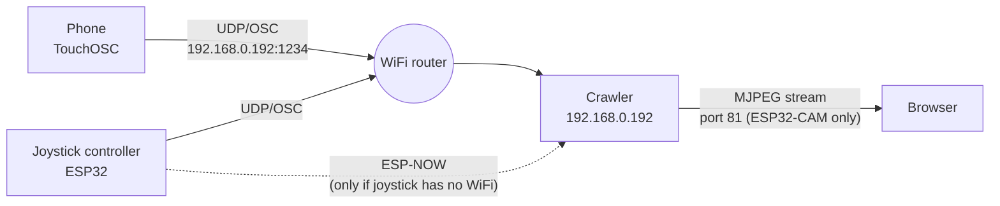
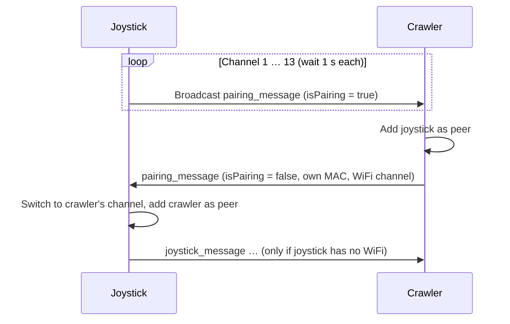

# Crawler

Remote-controlled tracked vehicles (crawlers) based on ESP microcontrollers. There are two crawler variants running the same firmware, and two ways to control them.


*Left: the Wemos crawler (beige). Right: the ESP32-CAM crawler with camera (dark green).*

| Variant | Controller | Motors | Extras |
|---|---|---|---|
| **ESP32-CAM crawler** ("type 1") | ESP32-CAM (AI-Thinker) | PCA9685 → DRV8833 | Camera with live stream; front, tail, brake and reversing lights |
| **Wemos crawler** ("type 2") | Wemos D1 mini (ESP8266) | DRV8833 directly on GPIO | WiFi status LED |

| Control | Hardware | Transport |
|---|---|---|
| **TouchOSC** | App on the phone | WiFi, UDP/OSC |
| **Joystick controller** | ESP32 with analog joystick, push button, 2 switches, 2 NeoPixels | WiFi UDP/OSC, or ESP-NOW as fallback when the joystick finds no WiFi |

All devices are battery powered.

## Repository contents

| Folder | Contents | Origin |
|---|---|---|
| `crawler/` | Firmware for both crawlers (version 10) | `combi10` |
| `OSC_Joystick/` | Firmware for the joystick controller (version 10) | `OSC_Joystick10` |
| `docs/` | Photo and schematics | – |

Version history according to the header comment in `crawler.ino`: 6 lights · 7 front lights · 8 camera · 9 restructured · 10 ESP-NOW handshake.

---

## System overview



The crawler always listens on UDP/OSC (port 1234) and ESP-NOW at the same time. The sender alone decides which path is used.

### Network settings (hard-coded)

| Parameter | Value | File |
|---|---|---|
| WiFi credentials | `ssid`, `password` from `<Credentials.h>` | both |
| Crawler IP | `192.168.0.192` (static), gateway `192.168.0.1`, mask `255.255.255.0` | `crawler/crawler.ino` |
| Crawler MAC | `3C:61:05:D0:53:5C` (set at startup) | `crawler/crawler.ino`, `OSC_Joystick/OSC_Joystick.ino` |
| Crawler OSC port | UDP `1234` | both |
| Joystick local UDP port | `8888` | `OSC_Joystick/OSC_Joystick.ino` |
| Hostname | `ESP-Crawler` (mDNS: `ESP-Crawler.local`, also used for OTA) | `crawler/crawler.ino` |

Because both crawlers use the same IP and the same MAC, only one can be operated at a time.

---

## Control

### 1. TouchOSC (phone)

The TouchOSC layout sends to `192.168.0.192:1234`:

| OSC address | Arguments | Effect |
|---|---|---|
| `/Crawler/xy1` | 2 floats X, Y (0…1) | XY pad for driving; only executed while the enable toggle is on |
| `/Crawler/toggle1` | 1 float (0/1) | Enable; switching it off stops the motors immediately |

The crawler identifies the sender by the number of arguments: two arguments mean phone (`isPhone = true`). The TouchOSC layout file is not in the repository yet.

### 2. Joystick controller (ESP32)

At power-on:

1. NeoPixel #0 lights red.
2. Connects to WiFi, at most 20 attempts of 0.5 s each. NeoPixel #1 blinks red meanwhile. Afterwards it is off if WiFi is connected, or steady red if not.
3. ESP-NOW pairing, see [ESP-NOW pairing](#esp-now-pairing).
4. Selects the transport. **ESP-NOW is only used if the joystick has no WiFi and pairing succeeded.** Otherwise it sends via UDP/OSC.
5. NeoPixel #0 shows the mode: green for OSC, blue for ESP-NOW.

During operation it sends every 20 ms, even without changes (`repetitive = true`).

| Control | OSC mode | ESP-NOW mode |
|---|---|---|
| Joystick X/Y | `/Crawler/xy1` with 3 arguments (X, Y, button) | `joystick_message` packet |
| Joystick button | 3rd argument → output "fireOut" (PCA channel 12) | sent as `button1`, but not evaluated by the crawler |
| Enable button | toggles `enableButton`, the button LED shows the state, sends `/Crawler/toggle1` → brighter front light on the ESP32-CAM crawler | no function |
| Switch L / R | no function | no function |

Scaling:

- OSC: X is mapped to 0.33…0.66, so steering is damped. Y is inverted and mapped to 1.0…0.0.
- ESP-NOW: the center is subtracted, a deadzone of ±50 applied, the value scaled to ±512, X divided by 5 and Y inverted.

In joystick mode (3 arguments) the crawler drives without the enable toggle.

### 3. Web interface (ESP32-CAM only)

- `http://192.168.0.192/` shows a page "RC Crawler 2d" with the camera image.
- `http://192.168.0.192:81/stream` delivers the MJPEG stream: VGA with PSRAM, SVGA without. The image is mirrored and flipped (rotated by 180°).
- `http://192.168.0.192/action?go=forward|backward|left|right|stop` accepts drive commands at a fixed speed `webSpeed = 150`. The page itself has no buttons for them.

---

## Protocols

### ESP-NOW messages

```c
typedef struct joystick_message {
  int16_t x;       // -512 … 512
  int16_t y;       // -512 … 512  (negative = forward)
  bool button1;
  bool button2;    // unused
  uint8_t target;  // unused (intended: 1, 2 or 0 = all)
} joystick_message;

typedef struct pairing_message {
  uint8_t mac_addr[6];
  uint8_t channel;
  bool isPairing;  // true = request, false = confirmation
} pairing_message;
```

The crawler distinguishes the two messages by their length.

### ESP-NOW pairing



In its confirmation the crawler reports the channel of its WiFi (`homeChannel`). If the joystick finds no crawler on any channel, ESP-NOW is considered unavailable.

---

## Drive and light logic (crawler)

**Mixing (tank steering):** `left = Y + X`, `right = Y − X`. The range ±512 is mapped to the PWM range: PCA ±4095 at 100 Hz, GPIO ±1023 at 20 kHz. Below a deadzone of 100 the motors stand still.

**Type detection at startup:** If a device answers on I²C address `0x40` (PCA9685), the crawler runs as type 1, otherwise as type 2.

**Lights (type 1 only, via PCA9685):**

| State | Lights |
|---|---|
| Startup | white reversing lights bright |
| Connecting to WiFi | white lights blink |
| WiFi connected | red tail light dimmed (200), front light low |
| Braking (twice above, then twice below the deadzone) | brake light: red +2000 for 1 s |
| Reversing (two packets in a row) | white reversing light (400) |
| `/Crawler/toggle1` in joystick mode | brighter front light (+65) |
| Joystick button | output "fireOut" (channel 12) fully on |

**Type 2:** The WiFi LED on D7 blinks while connecting and stays on once WiFi is connected.

---

## Hardware and schematics

The schematics are derived from the code. All three devices run on battery. Battery type, voltage regulators and the exact wiring of the DRV8833 modules are not defined in the code and are therefore not shown in detail.

### ESP32-CAM crawler (type 1)


| ESP32-CAM | Connection |
|---|---|
| GPIO13 | I²C SDA → PCA9685 |
| GPIO14 | I²C SCL → PCA9685 |
| GPIO4 | Flash LED, set as output (off) |
| GPIO12 | set HIGH at startup (comment: "because of PCA conflict with SDA") |
| Camera | internal AI-Thinker pinout (PWDN 32, XCLK 0, SIOD 26, SIOC 27, Y2–Y9, VSYNC 25, HREF 23, PCLK 22) |

| PCA9685 channel | Function |
|---|---|
| 2 / 3 | Motor 1 (left), IN1 / IN2 |
| 1 / 0 | Motor 2 (right), IN1 / IN2 |
| 4 / 8 | Red tail and brake light, right / left |
| 5 / 9 | White reversing light, right / left |
| 6 / 10 | Front light, right / left (base brightness 7 / 3) |
| 12 | "fireOut" (joystick button) |

### Wemos D1 mini crawler (type 2)


| Wemos pin | GPIO | Function |
|---|---|---|
| D6 | 12 | Motor 1 (left) IN1 |
| D5 | 14 | Motor 1 (left) IN2 |
| D1 | 5 | Motor 2 (right) IN1 |
| D2 | 4 | Motor 2 (right) IN2 |
| D7 | 13 | WiFi LED |

The motors run in "slow decay" mode: one input is held HIGH, the other receives the inverted PWM.

> The code also supports an ESP32 with motors directly on GPIO 12/13 (motor 1) and 27/25 (motor 2) and an LED on GPIO 14. On the ESP32-CAM these pins collide with the camera and I²C, so this variant only makes sense without `FPV`.

### Joystick controller (ESP32)


| GPIO | Function |
|---|---|
| 33 | Joystick X (ADC) |
| 32 | Joystick Y (ADC) |
| 25 | Joystick button (internal pull-up, active LOW) |
| 36 | Enable button (active LOW, external pull-up required) |
| 27 | Enable button LED |
| 35 / 34 | Switch L / R (not evaluated) |
| 14 | 2× WS2812: #0 right = mode, #1 left = WiFi |
| 5 | Board LED (on) |

---

## Building

**Common:** The file `Credentials.h` must be placed as a library in the Arduino `libraries` folder and define `ssid` and `password`. It is intentionally not part of the repository (see `.gitignore`).

Required libraries:

- `OSCMessage` (CNMAT OSC)
- `Streaming`
- `Adafruit PWM Servo Driver` (crawler)
- `Adafruit NeoPixel` (joystick)
- `ArduinoOTA`, `esp_camera`: included in the board package

**ESP32 board package:** The code uses `ledcSetup`/`ledcAttachPin` and the old ESP-NOW callback signature. It therefore requires Arduino-ESP32 core **2.x**, not 3.x.

**Crawler: selection at the top of `crawler/crawler.ino`**

| Target | Defines | Board |
|---|---|---|
| ESP32-CAM | `#define ESP32`, `#define FPV` | "AI Thinker ESP32-CAM" |
| Wemos D1 mini | `#define ESP8266`, comment out `FPV` | "LOLIN(WEMOS) D1 R2 & mini" |

`DEBUG` and `FIXESP` enable additional serial output (115200 baud).

**Joystick:** board "ESP32 Dev Module", or whichever matches the board used.

---

## Known issues / open tasks

This list comes from reading the version 10 code and is the basis for the upcoming fixes:

1. **WiFi/ESP-NOW fallback:** Only the joystick decides, and only once at startup. If the joystick has WiFi but the crawler does not, the joystick sends UDP into the void. There is no switch-over if WiFi is lost later.
2. **ESP8266 build:** `crawler/autoPairEspNow.ino` and `setup()` use the ESP32 ESP-NOW API (`esp_now_peer_info_t`, `esp_err_t`, `ESP_OK`). The ESP8266 variant in `ESP_Now.ino` is commented out. Whether the Wemos crawler compiles with version 10 needs to be checked.
3. **OTA on the ESP32-CAM:** `ArduinoOTA.handle()` is only called without `FPV`, so OTA is effectively disabled on the camera crawler.
4. **Joystick center hard-coded and inconsistent:** OSC uses `midX = 1947`, `midY = 1936`, ESP-NOW uses `joystickCenterX = 1935`, `joystickCenterY = 1947`. X and Y appear to be swapped.
5. **ESP-NOW without buttons:** `button1` and `target` are not evaluated by the crawler, and the enable button and front light do not work in ESP-NOW mode.
6. **Pairing:** The crawler accepts any pairing request, and `isPaired` is never reset. The joystick sends to the hard-coded `crawlerMAC` instead of the MAC reported during pairing. This only works because the crawler sets exactly that MAC.
7. **Same IP/MAC for both crawlers:** They cannot be operated at the same time.
8. **Switches L/R:** They are initialized but not used.
9. **Web page:** The `/action` handler exists, but the page has no control buttons.
10. **TouchOSC layout:** The layout file is still missing from the repository and will be added later.
